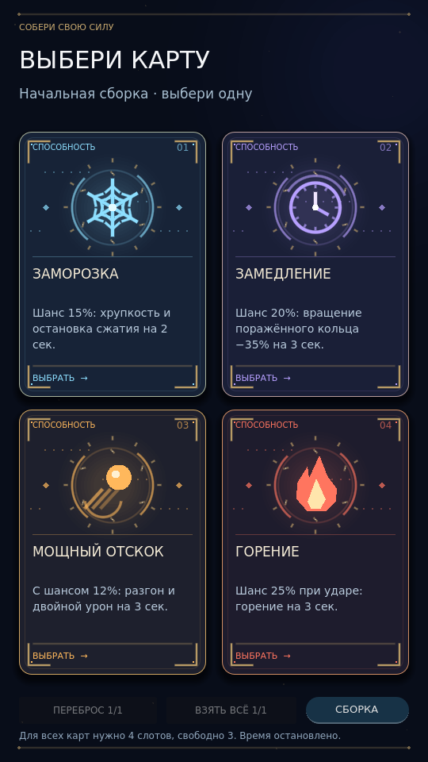
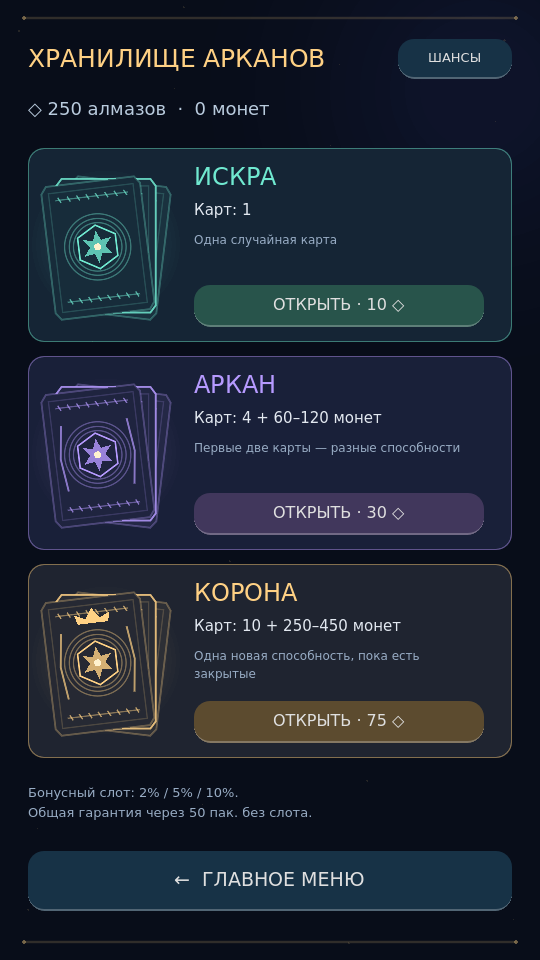

# Ringbreak — Прорыв

Android-игра на Godot: шарик пробивается через вложенные вращающиеся кольца, пока они сжимаются. В каждой попытке игрок заново собирает способности из карт и покупает усиления за временную энергию.

**Текущий прототип: 0.1.10 · Godot 4.6.3 · русский интерфейс.** Рабочее название Ringbreak пока не окончательное.

## Документация

- [Полное описание игры и актуальные формулы](docs/GAME_DESIGN_RU.md).
- [Запуск, проверки и сборка APK](docs/DEVELOPMENT_RU.md).

## Что реализовано

- Физическое движение с гравитацией, отражением от стенок и защитой от пролёта сквозь кольцо.
- Цельные кольца и кольца с одним/двумя разрезами. Проход через разрез уничтожает кольцо независимо от прочности.
- Сжатие, заморозка, замедление, отдача и сохранение порядка слоёв.
- От 48 до 84 колец на этап; выбор ранее открытого этапа и цветовые темы.
- Восемь способностей, раздачи из четырёх карт, разовый переброс и разовое получение всей четвёрки при наличии слотов.
- Энергия попытки, числовая прокачка урона и добычи, усиление параметров и цен на десятках.
- Постоянная коллекция, прокачка за повторные копии, три пакета с картами/монетами и бонусным слотом.
- Локальное сохранение; выплата 40% монет при поражении и 100% при победе.

Цель полной версии — около 200 разных способностей. Сейчас их восемь; баланс и визуальное оформление продолжают развиваться. Прототип проверялся на Windows и в автоматических симуляциях. Проверка текущей версии на физическом телефоне ещё не проводилась.

## Запуск

Откройте `project.godot` в **Godot 4.6.3** и запустите проект. Либо на Windows укажите движок в `GODOT_BIN` и выполните:

```powershell
$env:GODOT_BIN = 'C:\Tools\Godot\Godot_v4.6.3-stable_win64_console.exe'
.\scripts\run.ps1
.\scripts\check.ps1
```

Тесты используют отдельные сохранения; они не должны запускаться на пользовательском прогрессе без изоляции.

## Внешний вид

Неоновая арена сочетается с золотыми печатями и картами в стиле магических арканов. Иллюстрации процедурные, без внешних сервисов во время игры.





На скриншотах демонстрационный баланс. Состав пакетов и ограничения описаны в документации.

## Состав репозитория

`game.gd` — основная игровая логика и интерфейс; `pack_catalog.gd` — награды пакетов; `pack_screen.gd` — витрина и раскрытие; отдельные скрипты рисуют декор. В `tests/` — проверки механик и ввода.

Инструменты Godot/Java/Android SDK, сохранения игрока, ключ подписи и собранные APK в Git не включены. Лицензия шрифта DejaVu Sans находится в [FONT-LICENSE.txt](FONT-LICENSE.txt).
